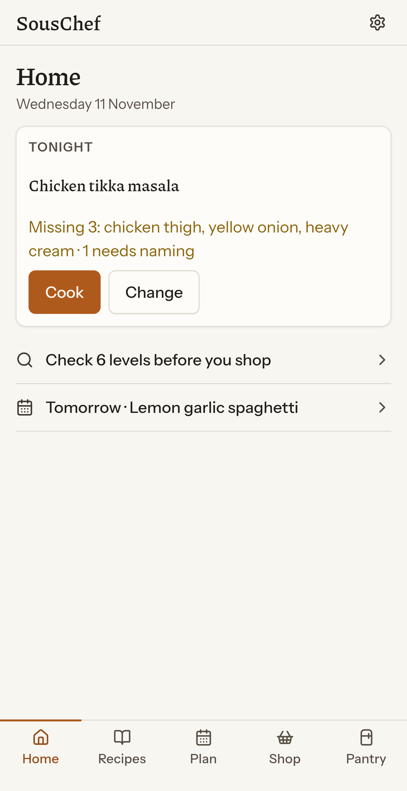
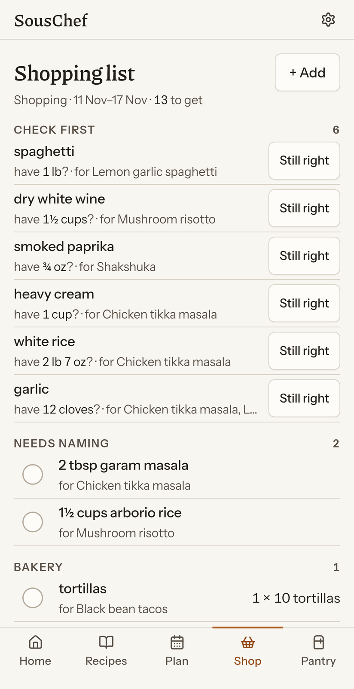
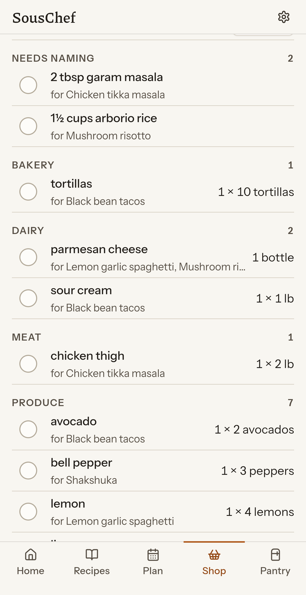
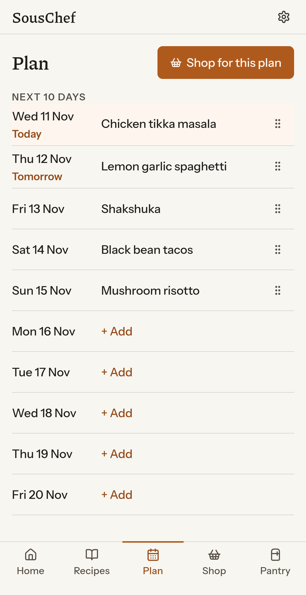
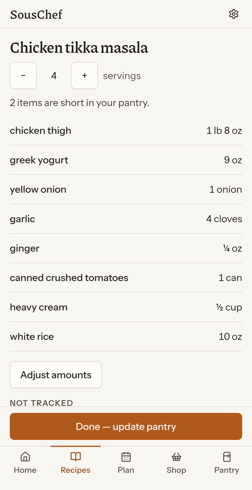
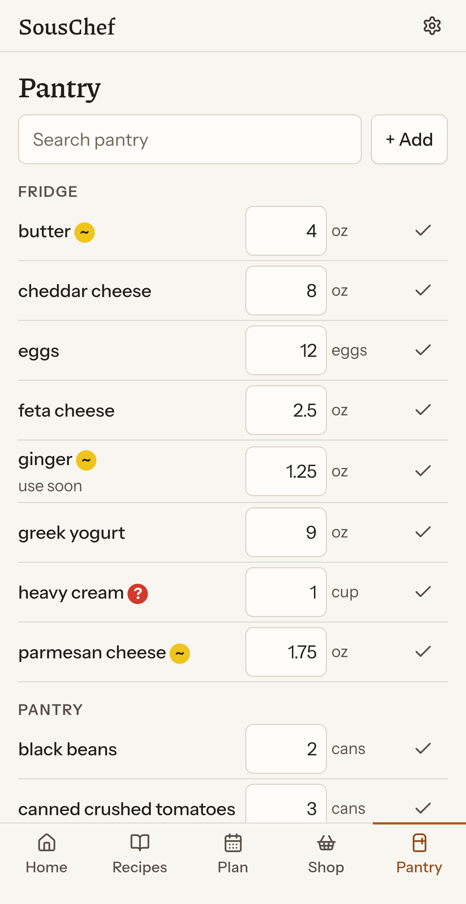

# SousChef

[](https://github.com/ethanez713/souschef/actions/workflows/ci.yml)

**A weekly meal planner that knows what is in your kitchen, and knows how sure it is.**
It suggests what you can cook, builds the shopping list, and before you shop asks you to
check only the few things it cannot be sure of.

## The idea

Most pantry apps demand a complete, accurate inventory as the price of admission. That
just moves the drudgery: you still audit everything, you just do it in an app.

SousChef assumes its inventory is **wrong, and knows how wrong**. Every level is a best
guess inside a range that widens with time and with each meal cooked. Before a shop it
asks about the handful of items where being wrong would change what you buy:

> **heavy cream** · have 1 cup? · for Chicken tikka masala &nbsp; `Still right`

Everything else stays silent. Confidently stocked, confidently empty, or not needed this
week: none of those are worth walking to the cupboard for. The target is a five-item
check, not an eighty-item audit.

<table>
  <tr>
    <td width="33%"></td>
    <td width="33%"></td>
    <td width="33%"></td>
  </tr>
  <tr>
    <td valign="top"><b>Home.</b> Tonight's dinner, what it is missing, and how many levels are worth a look before the next shop.</td>
    <td valign="top"><b>Check first.</b> Six questions, not a full audit. One tap confirms a level; a wrong one takes the real amount.</td>
    <td valign="top"><b>Shopping list.</b> Grouped by aisle, rounded to package sizes, each line naming the meal it is for.</td>
  </tr>
  <tr>
    <td width="33%"></td>
    <td width="33%"></td>
    <td width="33%"></td>
  </tr>
  <tr>
    <td valign="top"><b>Plan.</b> The next ten days, and one button to shop for them.</td>
    <td valign="top"><b>Cook.</b> What the recipe will take from the pantry, adjustable before it is logged.</td>
    <td valign="top"><b>Pantry.</b> Every level is a belief. The markers show which ones the app is unsure of.</td>
  </tr>
</table>

Captured on a phone from invented demo data: [`scripts/demo_data.py`](scripts/demo_data.py)
fills a throwaway database.

## The weekly loop

1. **Plan** meals, ranked by what you have, what is about to expire and what you have not
   cooked lately.
2. **Check** the few genuinely uncertain items.
3. **Shop** a list grouped by aisle and rounded to real package sizes ("1 × 2 lb chicken
   thighs", not "680 g of chicken").
4. **Cook**, and the pantry is debited for you.

## Run it

It runs on your own machine: no server to rent, no account, no sign-in.

```bash
python3 -m venv venv && ./venv/bin/pip install -e '.[dev]'

./venv/bin/souschef init      # database, key, ingredient catalog
./venv/bin/souschef serve     # http://127.0.0.1:8000
```

To try it with the demo kitchen in the screenshots, follow the header of
[`scripts/demo_data.py`](scripts/demo_data.py). To use it from your phone, put Tailscale
in front of it; that, backups, logs and where the data lives are in
[docs/RUNNING.md](docs/RUNNING.md).

## How it works

**The ingredient spine** (`core/units.py`, `core/matching.py`). Recipes speak in
volume, shops sell by weight, some things are counted. Reconciling them needs
per-ingredient physical facts — density, per-item weight — and the code refuses
to guess when they're missing rather than inventing a number.

Matching never strips a word the catalog itself uses, so "canned crushed
tomatoes" can't quietly degrade to fresh "tomatoes", and it splits product from
preparation at the comma, which is the only thing separating "tomatoes, diced"
from "diced tomatoes". Every correction you make is written to an alias table, so
the same wording resolves exactly the next time.

**The ledger** (`core/inventory.py`). Nothing writes a level directly; every
change appends an event first. State is always reconstructible, "why does it
think I have three onions?" is answerable, and undo is free.

**The audit** (`core/audit.py`). Ranks items by expected value of information:
the probability the belief is wrong *in a way that flips the buy decision*, times
the cost of being wrong. Being short an ingredient costs more than buying a
spare, so the two directions are weighted differently.

## Recipes and NYT Cooking

NYT Cooking has no public API and its terms prohibit automated scraping. So
imports are **one recipe at a time, on demand**: you give it a URL you're looking
at, it fetches that single page with your own session, and stops. No crawler, no
search backend, no bulk download.

Only your NYT **session cookie** is stored, encrypted, with the key held outside
the database. The password is never asked for — NYT blocks automated logins, and
a stored password would be far more damaging if the server were compromised.
Cookies expire; paste a fresh one when imports start failing.

Any other recipe site works too, via schema.org markup with `recipe-scrapers` as
a fallback.

## Choices worth knowing

**No server.** It runs where your kitchen is. Renting a VM for a household meal
planner means a hostname, certificates, a firewall, and a box to patch — all so
that data which never leaves the house can leave the house.

**SQLite, not Postgres.** A handful of people, no write concurrency to solve,
backups are one file, and tests run the identical engine.

**No LLM in the core loop.** Ingredient parsing is a CPU-only CRF model and
matching is deterministic. A matcher you can debug beats a model that's
confidently wrong, and everything here has to run on a laptop while dinner is
being planned.

**Server-rendered HTML + HTMX.** One service, one language, no build step.

**Staples are excluded from lists.** Salt, oil, and basic spices are assumed
present — otherwise every recipe looks unmakeable and every list runs ten items
long. Things you genuinely re-buy weekly are *not* staples, however basic they
feel; flagging pasta as a staple means a pasta recipe never tells you to buy
pasta.

## Testing

```bash
./venv/bin/python -m pytest tests/ -q        # fast: no network
./venv/bin/python -m pytest tests/ -m slow   # large fixtures and recorded network cassettes
```

The regression suite is built from failures found by running against real data. Several
were silent (a discarded line item, a tenfold quantity error) and none raised an
exception.

## License

MIT. Copyright (c) 2026 Ethan Zhou. See [LICENSE](LICENSE).

IBM Plex Mono, Instrument Sans, and Piazzolla, the fonts in
`src/souschef/static/fonts/`, are under the SIL Open Font License 1.1. Their
license texts are in `THIRD_PARTY_LICENSES/`.
