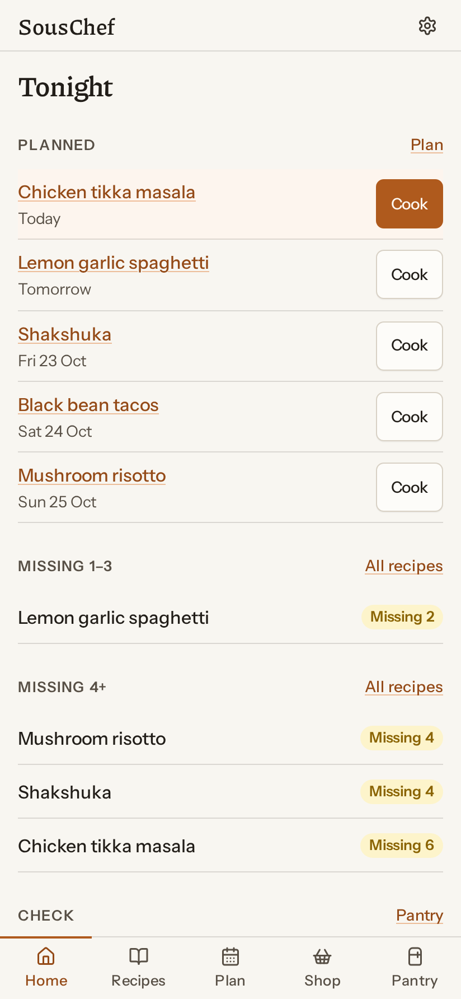
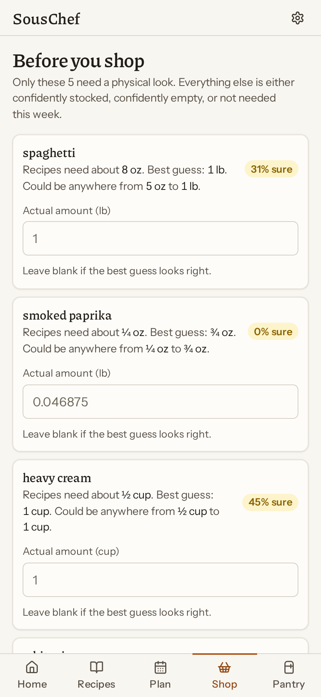
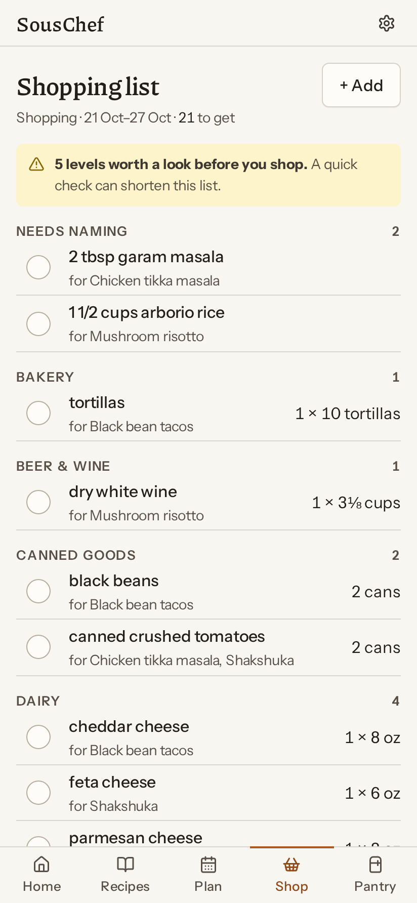
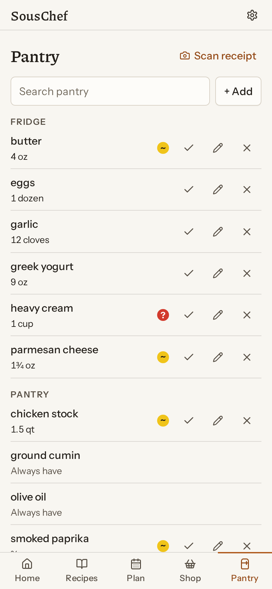
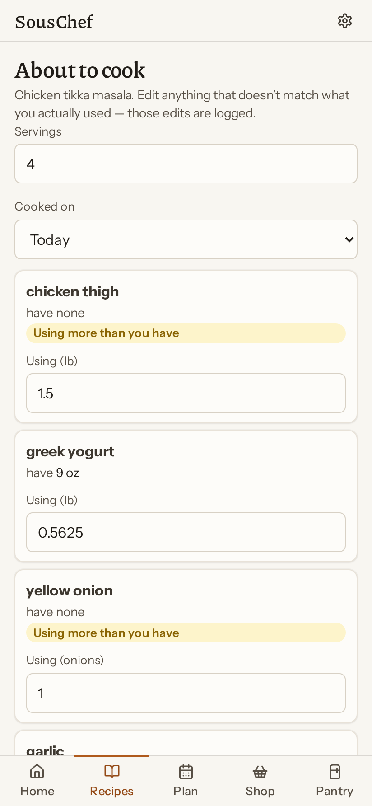
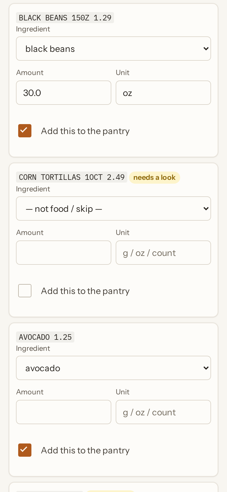

# SousChef

[](https://github.com/ethanez713/souschef/actions/workflows/ci.yml)

A weekly cooking planner that tracks your pantry, suggests recipes you can
actually cook, builds the shopping list, and updates itself from a photo of the
receipt.

## The idea

Most pantry apps demand a complete, accurate inventory as the price of
admission. That just moves the drudgery — you still audit everything, you just
do it in an app.

SousChef assumes its inventory is **wrong, and knows how wrong**. Every level
is a best guess inside a range that widens with time and with each meal cooked. Before you
shop, it asks you to physically check only the handful of items where the
uncertainty would actually change what you buy:

> Recipes need about 118 ml of heavy cream. Best guess: 400 ml, but that could be
> anywhere from 20 ml to 780 ml. **5% sure.**

Everything else stays silent. Confidently stocked, confidently empty, or not
needed this week — none of those are worth walking to the cupboard for. The
target is a five-item check instead of an eighty-item audit.

## The weekly loop

1. **Plan** — pick meals from Cook now / Nearly there / Bigger shop, ranked by
   what you have, what's about to expire, and what you haven't cooked lately.
2. **Check** — the pre-shop audit asks about the few genuinely ambiguous items.
3. **Shop** — a list grouped by aisle, rounded to real package sizes ("1 × 907 g
   chicken thighs", not "680 g of chicken"), each line saying which meal it's for.
4. **Scan** — photograph the receipt; matched line items are proposed for review.
   Nothing touches the pantry until you confirm.
5. **Cook** — tap "I cooked this" and levels are debited.

<table>
  <tr>
    <td width="33%"></td>
    <td width="33%"></td>
    <td width="33%"></td>
  </tr>
  <tr>
    <td valign="top"><b>Tonight.</b> Planned dinners first, then every recipe ranked by how many ingredients are missing.</td>
    <td valign="top"><b>Before you shop.</b> It asks only about the items whose uncertainty would change the list, each with a best guess, its range and how sure it is.</td>
    <td valign="top"><b>Shopping list.</b> Grouped by aisle and rounded to package sizes, each line naming the meal it is for. Recipe lines the catalog cannot name come first.</td>
  </tr>
  <tr>
    <td width="33%"></td>
    <td width="33%"></td>
    <td width="33%"></td>
  </tr>
  <tr>
    <td valign="top"><b>Pantry.</b> Every level is a belief with a confidence. One tap confirms it, edits it or marks it gone.</td>
    <td valign="top"><b>Cook.</b> Each ingredient's debit is shown and editable before the cook is logged, with a warning where the recipe uses more than the pantry is believed to hold.</td>
    <td valign="top"><b>Receipt scan.</b> Local OCR of a receipt photo. Lines that match the catalog are proposed with amounts, and nothing reaches the pantry until it is ticked and applied.</td>
  </tr>
</table>

Invented demo data in a throwaway database, from [`scripts/demo_data.py`](scripts/demo_data.py). The receipt is a rendered image of an invented receipt, scanned through the real upload.

## Running it

It runs on your own machine. There is no server to rent, no domain to point, and
nothing about it that assumes a network beyond the one you are sitting on.

```bash
python3 -m venv venv && ./venv/bin/pip install -e '.[dev]'

./venv/bin/souschef init      # database, key, ingredient catalog
./venv/bin/souschef serve     # http://127.0.0.1:8000
```

`init` generates the key the app needs and writes it to `~/.config/souschef/`,
mode 0600 — nothing to export and nothing left in a shell history. `secret_key`
encrypts the stored NYT cookie. Deleting it costs one re-paste of that cookie.

There is no sign-in. Every request acts as the one account. The first request
creates it when the database has none.

`souschef config` prints where everything ended up. `SOUSCHEF_NO_EXTERNAL=true`
blocks every outbound call, for a run that provably cannot reach a third party.

### From your phone

Run Tailscale on the machine that hosts SousChef and on the phone, then
`tailscale serve --bg --https=443 http://127.0.0.1:8000`. The phone reaches
`https://<machine>.<tailnet>.ts.net` over a real certificate, which is what
installing the app, the service worker, the share target and the clipboard
need. The server stays bound to loopback. `souschef serve` refuses any other
`--host`: other devices reach it through `tailscale serve`, which proxies to
loopback and presents the tailnet name.

A request is answered only when its Host is loopback or a `*.ts.net` name, so a
public DNS name pointed at the machine is refused. A state-changing request
whose `Origin` names a different host is refused too. Tailscale's `X-Forwarded-*`
headers are allowed; the proxy sets Host to the `ts.net` name.

### Accounts

One account, one kitchen: pantry, recipes, plan, shopping list, receipts and
the NYT cookie. The ingredient catalog is shared reference data about food.

The **Always have** list (`CanonicalIngredient.is_staple`) and **ingredients
typed in by hand** live on that catalog. Write to them directly.

### Other commands

```bash
souschef backup           # snapshot the database, keeping the last 14
souschef restore          # list snapshots; pass one to roll back to it
souschef scan photo.jpg   # dry-run OCR on a receipt, changes nothing
souschef rebuild          # recompute pantry levels by replaying the ledger
souschef config           # show effective configuration
souschef users            # list accounts
```

## Where your data lives

| Path | What |
|---|---|
| `data/souschef.db` | Everything: pantry, ledger, recipes, plans, accounts |
| `data/receipts/` | Receipt photos, stripped of EXIF on upload |
| `data/backups/` | Snapshots from `souschef backup` |
| `~/.config/souschef/` | The encryption key, deliberately not in the data directory |

`SOUSCHEF_DATA_DIR` moves the first three elsewhere.

```bash
souschef backup
souschef restore                                        # list what there is
souschef restore backups/souschef-20260818T193000Z.db   # roll back to one
```

Snapshots go through SQLite's backup API rather than a file copy, which would
risk a torn read mid-write. Restore replaces the live database, so stop the app
first; the database it replaces is kept beside it as `souschef.db.replaced`.

### Backing it with something other than this machine

Receipt images and snapshots are written through a small storage interface
(`src/souschef/storage/`), and the local filesystem is the only backend today. A
Google Drive backend is one class implementing that interface: blobs live in
Drive, and the database rides along as a `souschef backup` snapshot.

What will not work is putting the live SQLite file on a synced drive. SQLite
needs byte-range locks and an fsync that means something, and a sync client
gives it neither — you get silent corruption rather than an error. The keys stay
out of the data directory for a related reason: a key that syncs to a third
party is a key you have given away.

## How it works

**The ingredient spine** (`core/units.py`, `core/matching.py`). Recipes speak in
volume, shops sell by weight, some things are counted. Reconciling them needs
per-ingredient physical facts — density, per-item weight — and the code refuses
to guess when they're missing rather than inventing a number.

Matching never strips a word the catalog itself uses, so "canned crushed
tomatoes" can't quietly degrade to fresh "tomatoes", and it splits product from
preparation at the comma, which is the only thing separating "tomatoes, diced"
from "diced tomatoes". Every correction you make is written to an alias table, so
each receipt from a given store needs less fixing than the last.

**The ledger** (`core/inventory.py`). Nothing writes a level directly; every
change appends an event first. State is always reconstructible, "why does it
think I have three onions?" is answerable, and undo is free.

**The audit** (`core/audit.py`). Ranks items by expected value of information:
the probability the belief is wrong *in a way that flips the buy decision*, times
the cost of being wrong. Being short an ingredient costs more than buying a
spare, so the two directions are weighted differently.

**Receipts** (`ingest/`). OCR runs locally — receipts are transaction data, so
they never leave the machine, and the cloud fallback needs explicit per-receipt
consent. The parser reassembles OCR fragments into rows, repairs the O/zero
confusion that turns "8 OZ" into eighty ounces, merges the weight row that
receipts print under weighed goods, and filters out subtotals and payment lines
before anything reaches the matcher.

## Recipes and NYT Cooking

NYT Cooking has no public API and its terms prohibit automated scraping. So
imports are **one recipe at a time, on demand**: you give it a URL you're looking
at, it fetches that single page with your own session, and stops. No crawler, no
search backend, no bulk download.

Only your NYT **session cookie** is stored, encrypted, with the key held outside
the database. The password is never asked for — NYT blocks automated logins, and
a stored password would be far more damaging if the server were compromised.
Cookies expire; paste a fresh one when imports start failing.

Any other recipe site works too, via schema.org markup with `recipe-scrapers` as
a fallback.

## Logs

Everything goes to stdout in the terminal running the app, tagged with a request
id that is also returned in the `X-Request-ID` header — so a page that
misbehaved can be traced to every line it produced:

```
2026-07-27T11:35:29-0400 INFO  [31ce7e26] souschef.ocr: OCR receipt.png: 40 boxes -> 14 lines, confidence 0.95, 0.8s
2026-07-27T11:35:29-0400 INFO  [31ce7e26] souschef.receipt: Receipt 1 (SUPERGROCER): 9 items, 8 auto-matched, 1 need review
2026-07-27T11:35:29-0400 INFO  [31ce7e26] souschef.web: POST /receipts/upload -> 303 (1469ms)
```

Warnings are reserved for things worth acting on: an unreadable photo, a store
the matcher hasn't learned, a catalog gap that blocked a unit conversion.
`SOUSCHEF_LOG_LEVEL=DEBUG` for more.

Credentials are scrubbed by the formatter before anything is written, so logs
are safe to paste into an issue. `/healthz` returns 503 rather than 200 when the
encryption key is missing — an app that looks healthy while unable to decrypt
the stored NYT cookie is worse than one that is plainly down.

## Testing

```bash
./venv/bin/python -m pytest tests/ -q        # fast: no network, no models
./venv/bin/python -m pytest tests/ -m slow   # loads the real OCR models
```

The regression suite is built from failures found by running against real data,
not from sampling easy cases. Several were silent — a discarded line item, a
tenfold quantity error, a re-imported recipe reading back as "you have
everything" — and none would have raised an exception.

## Choices worth knowing

**No server.** It runs where your kitchen is. Renting a VM for a household meal
planner means a hostname, certificates, a firewall, and a box to patch — all so
that data which never leaves the house can leave the house.

**SQLite, not Postgres.** A handful of people, no write concurrency to solve,
backups are one file, and tests run the identical engine.

**No LLM in the core loop.** Ingredient parsing is a CPU-only CRF model and
matching is deterministic. A matcher you can debug beats a model that's
confidently wrong, and everything here has to run on a laptop while dinner is
being planned. A cloud vision model is touched only as a fallback for receipts
the local OCR can't read, and only with per-receipt consent.

**Server-rendered HTML + HTMX.** One service, one language, no build step.

**Staples are excluded from lists.** Salt, oil, and basic spices are assumed
present — otherwise every recipe looks unmakeable and every list runs ten items
long. Things you genuinely re-buy weekly are *not* staples, however basic they
feel; flagging pasta as a staple means a pasta recipe never tells you to buy
pasta.

## License

MIT. Copyright (c) 2026 Ethan Zhou. See [LICENSE](LICENSE).

IBM Plex Mono, Instrument Sans, and Piazzolla, the fonts in
`src/souschef/static/fonts/`, are under the SIL Open Font License 1.1. Their
license texts are in `THIRD_PARTY_LICENSES/`.
